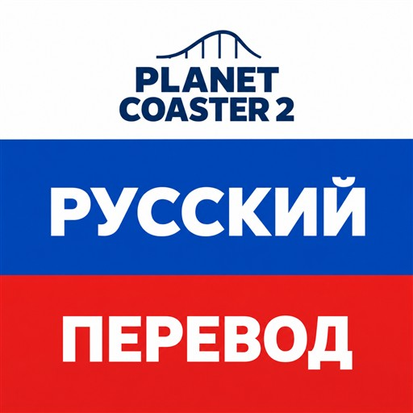

# Русификатор Planet Coaster 2

Русский текст для основной игры и всех дополнений, вышедших к версии **1.12.3**, включая **Spooktacular Pack** от 29 октября 2026 года.

**[Скачать актуальную версию](https://github.com/Stolzie071/planet-coaster-2-ru/releases/latest)** · [Инструкция](INSTALL.md) · [История версий](CHANGELOG.md)

| | Проверенная версия |
| --- | --- |
| Русификатор | **1.06** |
| Игра | **1.12.3**, Steam / Windows |
| Дата выпуска | **1 ноября 2026** |

В релизе скачивайте файл **Planet_Coaster_2_RU_1.06_Game_1.12.2.zip** – это готовый русификатор, около **29 МБ**. Автоматические архивы GitHub **Source code** содержат материалы этой страницы, для установки перевода они не нужны.

В версии **1.06** исправлены английские названия ингредиентов в готовых мыслях посетителей на картах карьеры и испытаний. Также уточнены подписи настроения персонала и название «Искусственные добавки».

## О переводе

Хотелось спокойно поиграть на русском. В итоге на большую переработку перевода ушло около двух недель: сверка с английским, разбор спорных названий и проверка надписей прямо в игре.

- Пересмотрен весь каталог: больше **36 тысяч строк**.
- Больше **24 тысяч строк** исправлены или переведены заново.
- Согласованы названия, термины, подсказки и сообщения; длинные подписи сокращены под интерфейс.
- Основные экраны и исправленные мысли первой миссии проверены в игре. Для первого выпуска проверена установка на чистые файлы Steam; для 1.06 проверены состав архива, распаковка и контрольные суммы.

Перевод охватывает интерфейс, обучение, тексты карьеры, описания объектов и текст дополнений. Озвучка остаётся оригинальной. Покупать DLC для установки русификатора не нужно; платные дополнения он не открывает.

## Установка

1. Закройте игру.
2. В Steam откройте **Свойства → Общие → Язык → English**. Дождитесь загрузки файлов, если Steam её начнёт.
3. Откройте **Свойства → Установленные файлы → Обзор**. В папке игры уже должны быть папки **Win64** и **Parks**.
4. Распакуйте ZIP русификатора в отдельную папку. Скопируйте из него **обе папки, Win64 и Parks**, в папку игры, подтвердив объединение папок и замену файлов.
5. Запустите игру. Язык в Steam оставьте **English**.

Правильные пути: `Planet Coaster 2\Win64\ovldata\...` и `Planet Coaster 2\Parks\...`, без лишних вложенных папок.

Папка **Parks** исправляет заранее записанные названия ингредиентов на семи готовых картах. Исправление применяется при новом запуске соответствующей миссии. Уже начатые сохранения не меняются и могут сохранить старые английские названия. Для остальных правок текста начинать заново не нужно.

Подробная инструкция и помощь с установкой – в [INSTALL.md](INSTALL.md) и файле **УСТАНОВКА.txt** внутри архива.

## Обновление и удаление

Для обновления скачайте подходящую сборку из [Releases](https://github.com/Stolzie071/planet-coaster-2-ru/releases/latest), закройте игру и повторите копирование с заменой файлов.

Для удаления закройте игру, оставьте в Steam язык **English** и запустите **Свойства → Установленные файлы → Проверить целостность файлов игры**. Steam восстановит оригинальную локализацию и исходные карты. Русификатор заменяет файлы локализации и семи готовых парков; сохранения не изменяет.

После нового патча сначала проверьте совместимость в начале этой страницы или в описании релиза. Совместимость с будущими версиями игры не обещается заранее. Обновления Steam и проверка целостности могут восстановить английские файлы; после этого подходящую сборку перевода нужно установить повторно.

## Сообщить об ошибке

Оставьте сообщение в [Issues](https://github.com/Stolzie071/planet-coaster-2-ru/issues). Приложите скриншот, версию игры и перевода и напишите, где находится надпись. Особенно полезны случаи, когда текст обрезается, налезает на соседнюю кнопку или не подходит по смыслу.

Весь каталог пересмотрен, но каждый экран во всех ситуациях в игре не проверялся. Название игры, бренды и часть имён могут оставаться на английском. Служебная строка **Cars per bus** пока намеренно сохранена в оригинале.

## Авторы основы и поддержка

За основу взят перевод сообщества, опубликованный **Allis**; в исходном руководстве также отмечена помощь **Voanerges**. Спасибо им за первоначальную работу. [Подробнее об авторах](CREDITS.md).

Если с переводом стало приятнее играть, можно [поддержать работу и оставить сообщение через DonationAlerts](https://www.donationalerts.com/r/stolzie). Русификатор бесплатный и доступен всем.
